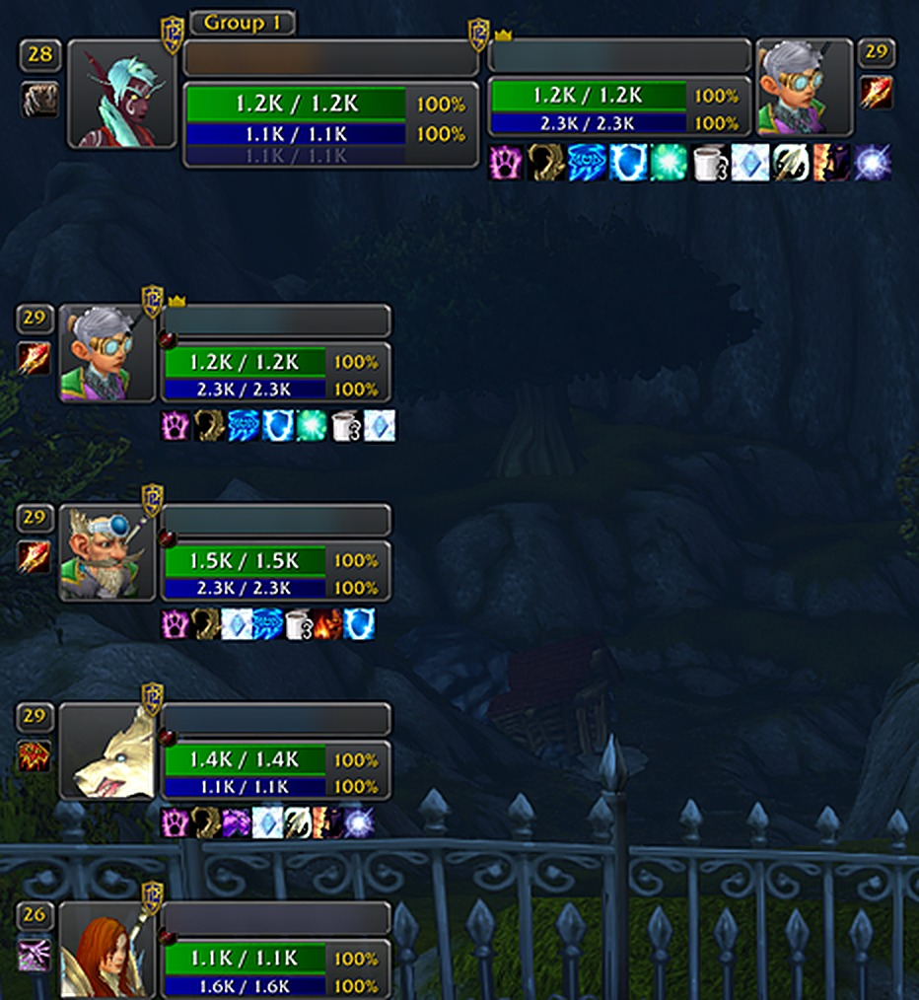

<div align="center">


# Perl Infinity

*The classic X-Perl unit frames, rewritten from scratch for WoW: Forever.*

[](LICENSE)
[](#install)
[](https://github.com/lovelaced/perl-infinity/tags)



</div>

Perl Infinity brings the dark boxes, square portraits and original bar textures of X-Perl to World of Warcraft: Forever. It replaces the game's player, target, party and raid frames, and you set it up with the game's own tools.

## Features

- **The X-Perl look**: dark translucent boxes, square portraits and the original bar textures.
- **All your frames**: player, pet, target, target of target, focus, party with each member's target and pet, and raid with raid pets.
- **Placement in Edit Mode**: drag your frames in the game's own layout editor, with snapping and positions saved per layout.
- **A settings window that feels native**: built from the game's own controls, with a live preview beside your settings.
- **Raid tools that work from your own client**: tank targets, a healer mana window, class buff checks, aggro warnings and saved raid layouts.
- **Healing and debuff cues**: incoming heals, heal over time bars, and highlights for debuffs you can remove.
- **Updates when something changes**: frames follow game events instead of checking constantly.
- **Profiles**: share settings between characters, or export a profile as a line of text and send it to a friend.

## Why Perl Infinity

- **Built for Forever from the first line.** WoW: Forever hides most health, power and aura values from addons. Perl Infinity was written around that rule rather than adapted from older code.
- **Careful with your CPU.** Frames update from game events. The only steady timers during normal play are a small one for units the game doesn't report on, like target of target, and a twice-a-second range check on frames you can see. In six logged beta sessions on one Mac, loading took 12 to 19 ms, and 2 of about 20,700 frame updates went over 5 ms. That's early data from before launch, not a raid benchmark.
- **No reliance on other players.** It sends no addon messages, so nothing depends on your group having it installed.
- **Easy to try.** It uses its own folder and saved settings, so it won't overwrite an X-Perl or Z-Perl setup. Turn your other unit frame addon off while you try it. If you turn a Perl Infinity frame off, the game's own frame comes back after a reload.
- **Tested outside the game and inside it.** An offline test suite runs every frame through simulated combat and Forever's data rules, and fails on any Lua error or blocked action. Simulations can't catch everything, so `/pinf selftest` also checks your real game, including whether everything the addon relies on still exists after a patch.
- **Actively maintained and open source.** Perl Infinity launched with WoW: Forever in November 2026, and it's maintained by a longtime Z-Perl player who uses it. It's new, so there's no long track record yet, but every change is public in the [commit history](https://github.com/lovelaced/perl-infinity/commits/main) and bug reports go straight to the maintainer. It's free under the GPL.

## Install

Perl Infinity isn't on CurseForge yet. To install it now:

1. Download this repo with **Code > Download ZIP**, or clone it.
2. Copy the `PerlInfinity` folder into `World of Warcraft/_forever_/Interface/AddOns/`.
3. Restart the game.

Perl Infinity only loads on WoW: Forever.

## Usage

Type `/perlinfinity` or `/pinf` to open the options. You can also find it under **Options > AddOns**, or in the addon button on your minimap.

To move a frame, open Edit Mode with `/pinf move` and drag it. Party targets and party pets each have their own box, so you can place them apart from the party. They stay beside the party until you drag them, and **Reset position** in the box's popup puts them back.

| Command | What it does |
|---|---|
| `/pinf` | Opens the options |
| `/pinf move` | Opens Edit Mode so you can move your frames |
| `/pinf player`, `pet`, `target`, `tot`, `focus`, `party`, `raid`, `tools`, `profiles` | Opens that page |
| `/pinf profile [name]` | Switches to a profile. With no name, lists your profiles |
| `/pinf tanks` | Shows or hides the tank targets window |
| `/pinf mana` | Shows or hides the healer mana window |
| `/pinf layouts save [name]`, `load [name]`, `stop` | Saves your raid groups, puts everyone back, or stops |
| `/pinf buffs` | Lists who in your group is missing a class buff |
| `/pinf names` | Opens a list of your raid's names you can copy |
| `/pinf reset positions` | Puts every frame back where it started |
| `/pinf selftest` | Checks Perl Infinity against your game and saves a report |

### Reporting a bug

Run `/pinf selftest`, then [open an issue](https://github.com/lovelaced/perl-infinity/issues) and describe what you saw. The report is saved in `WTF/Account/<your account>/SavedVariables/PerlInfinity.lua`, so attach that too if you're happy to share it.

## How it differs from X-Perl

Perl Infinity keeps X-Perl's look and most of its features, but it's new code. This comparison is against Z-Perl, X-Perl's successor.

Most of the changes come from one rule: Forever hides most health, power and aura values from addons. An addon can hand those values to the game to display, but it can't read them, compare them or add them up.

### What works differently

| | X-Perl and Z-Perl | Perl Infinity | Why |
|---|---|---|---|
| **Moving frames** | Unlock, drag, and resize with a grip | The game's Edit Mode | You arrange your whole screen in one place, with positions saved per layout |
| **Settings** | Its own options window | A window built from the game's controls, with a live preview | It behaves like the rest of the game's interface |
| **Health and power** | The addon reads the numbers and works out bars and text | The game fills in the bars, text and colors | Forever hides these numbers |
| **Buffs and debuffs** | The addon reads each one and draws its icon | The game draws them, using filters Perl Infinity sets | Their details are hidden in combat |
| **Incoming heals** | A shared library that had other players' addons report their heals | The game's own heal prediction | That library can't work on Forever |
| **Range** | You pick a spell or item, or a fixed 40-yard check | It picks one of your class spells, or uses a 40-yard check | Less to set up |
| **Updates** | Timers across many frames | Game events, plus two small timers | It keeps CPU use low |
| **Raid tools** | Some rely on data shared between players' addons | Only what your own client can see | Forever locks addon messages in instances |
| **Languages** | English plus several others | English for now | All the text is in one table, ready for translators |

### What's gone, and why

**Forever hides the data they need:**

- Target counters and the assists window. Who's targeting whom is hidden on dungeon and raid maps.
- Raid mana and health totals. Addons can't add up hidden values.
- Heal over time counters, heal sparkles and "buffs until debuffed".
- Duplicate-target borders on tank frames, caster names in aura tooltips and per-class aura exception lists.

**They need other players' addons:**

- Durability, resistance and reagent checks. They relied on other players' addons replying, and Forever locks addon messages in instances.

**Forever doesn't need them:**

- Bars for class resources from later expansions, vehicle swaps and pet battle handling.
- Compatibility code for addons such as CT_RaidAssist, BigWigs and HealBot.

**Your old settings don't carry over:**

- There's no import from X-Perl or Z-Perl profiles, so you start fresh.

### Limits to know about

- Buff checks only work out of combat, because buff details are hidden during fights.
- The threat gauge shows only a color when the game keeps the exact numbers secret, which happens in some boss fights.

### What you keep

Heal over time glows and bars, the being-healed glow, the threat needle, damage and healing numbers over portraits, debuff highlights, cast bars, range fading and the low-health warning are all here, rebuilt on what Forever allows.

## Development

The tests run outside the game and need [LuaJIT](https://luajit.org/).

```bash
make test-all   # runs the offline test suite in all three modes
make lint       # checks the code (uses luacheck if you have it)
make deploy     # copies the addon into the game (set WOW_DIR if yours isn't the default macOS path)
make package    # builds PerlInfinity-<version>.zip in .release/
```

`make gen` regenerates the test suite's API data. It needs a copy of the game's interface source, which you point to with `WOW_UI_SOURCE`.

## Credits

Perl Infinity is new code, but it comes from a long line of unit frames: Perl UnitFrames by Nymbia, X-Perl UnitFrames by Zek, and Z-Perl by Resike and contributors. The frame and bar textures come from Z-Perl.

This project began under the working name F-Perl. Zeta0xD published [F-Perl](https://www.curseforge.com/wow/addons/fperl) first, so that name is theirs. It's a separate addon, and worth a look if you're comparing your options.

## License

Perl Infinity is released under the [GPL-3.0-or-later](LICENSE).

The bundled library in `PerlInfinity/Libs/LibEditMode` is by Adrian L Lange and keeps its own license, which is included in that folder. It's redistributed unmodified, as its terms allow.
